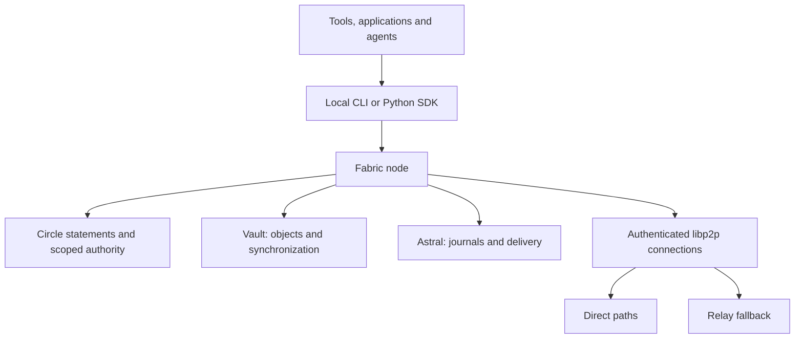

# Architecture and trust boundaries

Fabric combines connectivity, resource ownership, data and messaging in one
node process. Applications can use its local APIs without implementing peer
discovery, NAT traversal or the circle grant verifier themselves.

## Identities and ownership

A **device** has an Ed25519 libp2p identity. A **circle** is an ownership
domain identified by a DID, with its own admissions, grants, revocations
and key history. A node can hold several circles. The transport admits the
union of its valid device memberships; resource operations check the
particular circle that owns a bucket or queue.

An owner admits devices without giving them the owner key. Devices can
issue attenuated sub-keys for local clients. A foreign worker can receive
a resource grant without joining as a device. Admissions, grants and
revocations share one signed CBOR statement format and chain verifier.

Circle gossip is scoped to that circle. Dark nodes refuse unknown inbound
peer identities before application protocols. Listed nodes provide chosen
contact points. Holding two circles does not automatically forward their
IP traffic or share their resource catalogs.

The circle's identifier remains its original DID across its internally
verified key handovers. This is IOA's statement/key-history protocol; it
does not add update semantics to the external `did:key` method.

## Connectivity

The node owns one libp2p host, encrypted peer connections, signed address
records, reconnects, NAT traversal and relay fallback. A lighthouse is an
operational role: an available node that accepts admission requests and
helps admitted peers connect. It need not hold a circle's owner key.

The optional TUN bridge exposes ordinary IP networking. It currently
serves the first configured overlay; full multiple-overlay data planes are
unfinished. The bridge fences traffic to its endpoint addresses and prefix
instead of becoming a router between circles.

## Data and delivery

**Vault** stores immutable BLAKE3-addressed content and replicated object
metadata. Per-device placement selects complete copies, cache storage,
folder replicas, or metadata with on-demand reads. Bucket ownership and
per-bucket verbs gate synchronization and content transfer. See the
[Vault guide](../vault/README.md) for deletion, retention and conflict behavior.

**Astral** stores ordered journals and delivery state. Claims have leases;
acknowledgements and completed calls are journaled. Every resource verb is
checked against the calling device's or sub-key's statement chain. Replies
are signed and checked at the caller, including current authority.

An ordinary queue has one authoritative host. Spread placement chooses
among independent journals and improves availability of new work; it does
not replicate old work. Transport delivery is at least once. A runtime such
as Entourage still needs to commit its state and outgoing intents together,
persist incoming mail before transport acknowledgement, and retry safely.

## Boundaries to understand

- The root/circle owner key is unlocked for signing in a CLI/UI process.
  The daemon holds the hot device key and authorized state.
- Local Unix sockets form one operator-user trust domain. Scoped SDK calls
  do not prevent a process with access to those sockets from making other
  operator calls; isolate its credentials and runtime accordingly.
- Authorized storage and queue hosts can read their stored content. Private
  resource permissions are not recipient-only encryption against the host.
- Network encryption does not hide all peer metadata or provide anonymity.
- Revocation propagates through contact. Disconnected nodes cannot know a
  removal they have not yet received; expiry bounds credential lifetimes.
- Data delivery does not schedule programs, decide task policy, or guarantee
  exactly-once effects in external systems.

## Source map

| Package | Responsibility |
| --- | --- |
| `did`, `statement`, `circle`, `cert` | Key identifiers, authority chains, circle state and admissions. |
| `fabricnet`, `daemon`, `admission` | Peer membership, transport, gossip and onboarding. |
| `keystore`, `state` | Encrypted owner-key storage and device configuration. |
| `astral` | Journals, leases, request/reply and its daemon/CLI. |
| `vault` | Bucket metadata, content storage, synchronization, folders and mounts. |
| `tunbridge`, `fabricdns` | Optional IP attachment and `.fabric` names. |
| `webui` | Local topology, resource and administration UI. |
